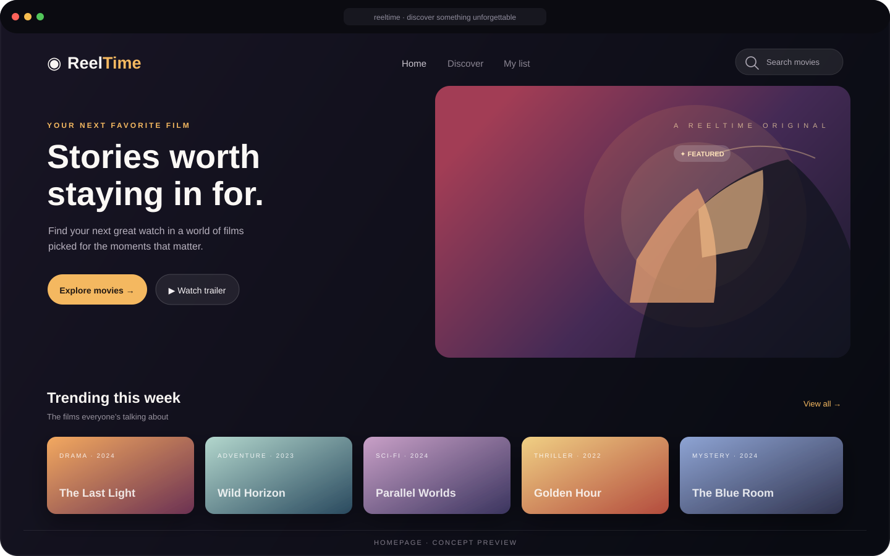
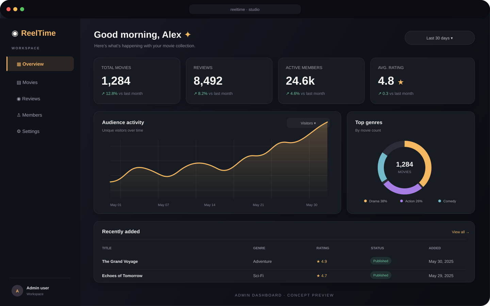

<div align="center">

# 🎬 ReelTime

### Discover your next favorite movie.

A full-stack movie discovery application built with React, Spring Boot, and MongoDB.

[](https://github.com/zynfaria/full-stack-movie-project)
[](https://react.dev/)
[](https://spring.io/projects/spring-boot)
[](https://www.mongodb.com/)
[](https://www.java.com/)

</div>

---

## ✨ Product previews

A cinematic movie-browsing experience, paired with a dashboard concept for managing a movie catalog.

| Homepage | Admin dashboard concept |
|:---:|:---:|
|  |  |

> **Note:** These are illustrative UI concept previews created for the README, not screenshots of running application pages. The repository currently focuses on the movie discovery app; the admin dashboard is a visual concept.

---

## Overview

ReelTime lets users browse a collection of films, view movie details, watch trailers, and submit reviews. The project brings together:

- A React front end for a cinematic browsing experience
- A Java + Spring Boot REST API for movie and review operations
- MongoDB for persistent movie and review data

This repository is a full-stack learning and showcase project combining user-facing UI with backend functionality.

## Tech stack

| Layer | Technology |
| --- | --- |
| Front end | React 18, React Router, Axios, Bootstrap, Material UI |
| Back end | Java 20, Spring Boot 3.1, Spring Web |
| Database | MongoDB |
| Build tools | npm, Maven |
| Environment config | Java properties + environment variables |

## Features

- Browse a curated movie collection
- View detailed movie information
- Watch movie trailers
- Submit and store user reviews
- REST API for movie and review operations
- MongoDB integration for persistent film data

## Project structure

```text
full-stack-movie-project/
├── back-end/
│   └── movie-client/
│       └── movie-gold-v1/          # React movie web app
├── front-end/
│   └── movies/                     # Spring Boot API
│       └── src/
│           ├── main/
│           └── test/
├── docs/
│   └── images/                     # README preview artwork
└── README.md
```

> The current repository layout places the React client under `back-end/` and the Java backend under `front-end/`.

## Getting started

### Prerequisites

- Node.js and npm
- Java 20
- MongoDB access configured
- Git

### Configure MongoDB

The backend reads these environment variables for MongoDB connectivity:

```text
MONGO_DATABASE
MONGO_USER
MONGO_PASSWORD
MONGO_CLUSTER
```

They are referenced in `front-end/movies/src/main/resources/application.properties`. Example configuration:

```properties
spring.data.mongodb.database=${MONGO_DATABASE}
spring.data.mongodb.uri=mongodb+srv://${MONGO_USER}:${MONGO_PASSWORD}@${MONGO_CLUSTER}
```

Keep your credentials private; do not hardcode them in the repository.

### Run the backend API

```bash
cd front-end/movies
./mvnw spring-boot:run
```

On Windows:

```bat
cd front-end\movies
mvnw.cmd spring-boot:run
```

The API runs at `http://localhost:8080`.

### Run the React client

In a second terminal:

```bash
cd back-end/movie-client/movie-gold-v1
npm install
npm start
```

The client runs at `http://localhost:3000` and communicates with the backend at `http://localhost:8080`.

## API

Base URL: `http://localhost:8080/api/v1`

| Method | Endpoint | Description |
| --- | --- | --- |
| GET | `/movies` | Get all movies |
| GET | `/movies/{imdbId}` | Get a movie by IMDb ID |
| POST | `/reviews` | Create a review |

Example review request:

```bash
curl -X POST http://localhost:8080/api/v1/reviews \
  -H "Content-Type: application/json" \
  -d '{"reviewBody":"Great movie and smooth experience!","imdbId":"movie-id"}'
```

## Useful commands

**React client**

```bash
cd back-end/movie-client/movie-gold-v1
npm start
npm test
npm run build
```

**Spring Boot API**

```bash
cd front-end/movies
./mvnw test
./mvnw package
./mvnw spring-boot:run
```

## Future improvements

- Add an `.env.example` file
- Implement search and filtering
- Improve review form validation
- Add more movie detail pages and categories
- Add production-ready deployment configuration
- Expand automated test coverage

## Contributing

Contributions are welcome. Open an issue or submit a pull request with your improvements.

## License

This project currently does not specify a license. Consider adding an open-source license if you plan to share or distribute it.

---

<div align="center">

Built for movie lovers. 🍿

</div>
